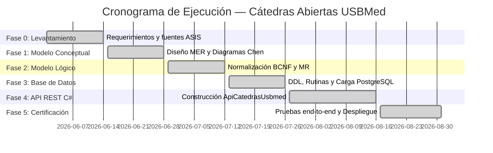

# Guía de Gestión del Cronograma — Cátedras Abiertas USBMed

Esta guía establece la planificación temporal, la Estructura de Desglose del Trabajo (WBS), la asignación de recursos, el diagrama de Gantt y el protocolo de control de cambios para la ejecución del proyecto **Cátedras Abiertas USBMed**.

---

## 1 · Estructura de Desglose del Trabajo (WBS / EDT)

El proyecto se divide en 6 fases consecutivas con entregables verificables:

```
1. Proyecto Cátedras Abiertas USBMed
   ├── 1.0 Fase 0: Levantamiento y Perfilado de Fuentes
   │   ├── 1.0.1 Entrevista técnica y transcripción de requerimientos (Prof. Carlos A. Castro)
   │   ├── 1.0.2 Perfilado de datos del maestro ASIS (Excel)
   │   └── 1.0.3 Definición de las 38 reglas de negocio (RN-01 a RN-38)
   ├── 1.1 Fase 1: Diseño Conceptual (MER)
   │   ├── 1.1.1 Identificación de 33 entidades y atributos
   │   ├── 1.1.2 Construcción de 6 diagramas Chen en Draw.io
   │   └── 1.1.3 Validación de opcionalidad y participaciones
   ├── 1.2 Fase 2: Diseño Lógico (MR)
   │   ├── 1.2.1 Normalización a Forma Normal de Boyce-Codd (BCNF)
   │   ├── 1.2.2 Mapeo de relaciones 1:N y M:N
   │   └── 1.2.3 Documentación del esquema relacional y acceso
   ├── 1.3 Fase 3: Diseño Físico en PostgreSQL
   │   ├── 1.3.1 Creación de scripts DDL (37 tablas, 52 FKs, 47 Checks)
   │   ├── 1.3.2 Implementación de disparadores (Triggers) y 10 Funciones/Procedimientos
   │   └── 1.3.3 Carga de datos reales (~41.000 registros del ASIS)
   ├── 1.4 Fase 4: Desarrollo de la API REST (.NET 8)
   │   ├── 1.4.1 Estructura base (.NET 8, Dapper, Swashbuckle, BCrypt)
   │   ├── 1.4.2 Generador automático de código (generar.py)
   │   ├── 1.4.3 Capa de autenticación JWT y Capa de Procesos
   │   └── 1.4.4 Exportación del archivo plano del ASIS (ClosedXML)
   └── 1.5 Fase 5: Pruebas, Certificación y Despliegue
       ├── 1.5.1 Ejecución de suite de pruebas Bash (flujo-completo.sh y certificacion.sh)
       ├── 1.5.2 Verificación de seguridad y fail-fast de configuración
       └── 1.5.3 Configuración de servicio systemd / producción
```

---

## 2 · Cronograma General y Diagrama de Gantt

El desarrollo completo se estimó en una duración total de **10 semanas**, distribuidas según la ruta crítica del proyecto:



---

## 3 · Matriz de Hitos Críticos y Entregables

| Hito | Entregable Clave | Fecha Compromiso | Estado |
|---|---|---|---|
| **H1: Requisitos** | Documentos `PLAN-BD-CATEDRAS-ABIERTAS.md` y transcripción | Semana 2 | ✅ Completado |
| **H2: Modelo MER/MR** | Archivos `.drawio` y especificación BCNF | Semana 4 | ✅ Completado |
| **H3: Base de Datos SQL** | Scripts `00` a `18` en `SOLUCION/fisico_postgres/` ejecutados sin errores | Semana 6 | ✅ Completado |
| **H4: API REST .NET 8** | Código fuente `ApiCatedrasUsbmed` compilando y documentado en Swagger | Semana 8 | ✅ Completado |
| **H5: Exportador ASIS** | Generación correcta del archivo Excel de 3 columnas sin encabezado | Semana 9 | ✅ Completado |
| **H6: Certificación** | Ejecución exitosa de `flujo-completo.sh` y `certificacion.sh` | Semana 10 | ✅ Completado |

---

## 4 · Gestión de la Ruta Crítica y Control de Desvíos

### 4.1 · Tareas en la Ruta Crítica
1. **Modelado BCNF de Asistentes e Identidades:** Cualquier cambio en la estructura de `asistente` o `documento_asistente` retrasa tanto la base de datos como los modelos Dapper de la API.
2. **Procedimiento Almacenado `sp_registrar_asistencia`:** Lógica de validación de cuotas y ventana temporal (RN-15). Debe estar 100% probado antes de exponer el endpoint HTTP.
3. **Generación del Archivo Plano ASIS:** Requisito no negociable de interoperabilidad con el sistema institucional de la universidad.

### 4.2 · Protocolo de Control de Cambios en el Cronograma
1. **Solicitud de Cambio:** Cualquier modificación en las reglas de negocio debe documentarse indicando impacto en horas.
2. **Evaluación de Impacto:** Si el cambio afecta a la base de datos, se ejecuta `python generador/generar.py` para regenerar la API automáticamente, minimizando el impacto en la programación.
3. **Aprobación:** Cambios que modifiquen la fecha final requieren validación del comité técnico del proyecto.
