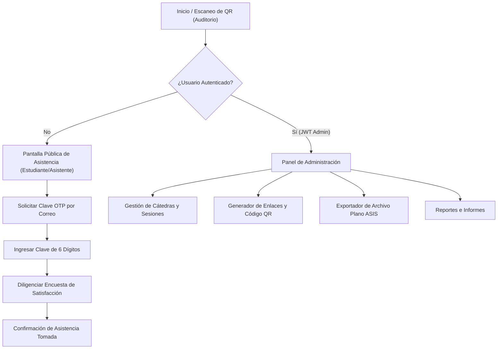

# Guía de Interfaz Gráfica (UI/UX) — Cátedras Abiertas USBMed

Esta guía especifica los principios de diseño de experiencia e interfaz de usuario (UI/UX), arquitectura de la información, flujos de pantalla y componentes visuales para la plataforma de **Cátedras Abiertas** de la **Universidad de San Buenaventura, Medellín (USBMed)**.

---

## 1 · Sistema de Diseño y Guía de Estilos Visuales

La interfaz utiliza la paleta de colores institucional de la Universidad de San Buenaventura (USBMed), garantizando contraste accesible (cumpliendo con la norma WCAG 2.1 AA) y legibilidad en dispositivos móviles.

### 1.1 · Paleta de Colores

| Rol | Color / Código Hex | Uso principal |
|---|---|---|
| **Primario Institucional** | `#1A365D` (Azul San Buenaventura) | Encabezados, barras de navegación, botones primarios |
| **Secundario / Acento** | `#C53030` (Rojo Velo Franciscanos) | Botones de acción destacados, insignias, alertas |
| **Fondo Principal** | `#F7FAFC` (Gris Claro) | Fondo de aplicación |
| **Fondo Tarjeta / Contenedor** | `#FFFFFF` (Blanco Puro) | Paneles, formularios, modales |
| **Texto Principal** | `#2D3748` (Gris Oscuro) | Lectura general y títulos |
| **Estado Éxito** | `#2F855A` (Verde Esmeralda) | Mensajes de confirmación, QR válido, asistencia tomada |
| **Estado Error** | `#C53030` (Rojo Intenso) | Mensajes de error, fuera de ventana, cupo lleno |
| **Estado Advertencia** | `#D69E2E` (Ámbar) | Avisos de cierre próximo de ventana |

### 1.2 · Tipografía y Jerarquía

* **Fuente Principal:** `Inter`, `Roboto` o `system-ui`, sans-serif.
* **Jerarquía:**
  * **H1 (Título Principal):** `24px / 1.3`, Semibold (600).
  * **H2 (Sección):** `18px / 1.4`, Medium (500).
  * **Cuerpo de texto:** `14px / 1.5`, Regular (400).
  * **Botones y Etiquetas:** `14px / 1.2`, Medium (500), Uppercase para acciones clave.

---

## 2 · Arquitectura de la Información y Flujos de Pantalla

El sistema distingue dos perfiles de usuario principales con interfaces optimizadas según el caso de uso:



---

## 3 · Especificación de Pantallas Clave

### 3.1 · Pantalla 1: Registro Móvil de Asistencia (Vista Estudiante / Asistente)

Pantalla ultraligera cargada al escanear el código QR desplegado en el auditorio.

> [!TIP]
> **Diseño Mobile-First:** Diseñada para pantallas de smartphones (desde 360px de ancho). Carga en menos de 1 segundo bajo redes móviles 3G/4G.

* **Encabezado:** Logo institucional USBMed y título de la Cátedra Abierta activa.
* **Componentes:**
  1. **Tarjeta de Información:** Nombre de la sesión, ponente, sede (San Benito / Salento / Bello) y horario.
  2. **Campo Identificador:** Caja de texto para ingresar Documento de Identidad o Correo Institucional.
  3. **Botón Solicitar Clave:** Botón destacado con estado de carga al enviar la clave dinámica al correo.
  4. **Campo Clave OTP:** 6 casillas numéricas individuales con autofoco.
  5. **Sección de Encuesta Integrada:** Escala de valoración de 1 a 5 estrellas para la calidad del ponente y temática.
  6. **Botón Registrar Asistencia:** Acción final.

#### Mockup de la Interfaz del Registro Móvil
```
┌──────────────────────────────────────────┐
│  [Logo USBMed]                           │
│  Cátedras Abiertas — San Benito          │
├──────────────────────────────────────────┤
│ 📌 Cátedra: Pedagogía Electoral 2026-1   │
│ 🕒 Ventana Activa: 14:00 - 16:00          │
├──────────────────────────────────────────┤
│ Ingrese su documento o correo:           │
│ [ 1000513928                           ] │
│                                          │
│ [  SOLICITAR CLAVE DE REGISTRO  ]        │
├──────────────────────────────────────────┤
│ Clave de 6 dígitos enviada a su correo:   │
│ [ 4 ] [ 8 ] [ 1 ] [ 9 ] [ 2 ] [ 0 ]      │
├──────────────────────────────────────────┤
│ ¿Cómo califica la calidad del ponente?   │
│ ⭐ ⭐ ⭐ ⭐ ⭐                              │
│                                          │
│ [  REGISTRAR ASISTENCIA AHORA  ]         │
└──────────────────────────────────────────┘
```

---

### 3.2 · Pantalla 2: Panel de Administración y Control (Vista Administrador)

Interfaz de escritorio para la emisión de enlaces, control de ventanas de asistencia y exportación.

* **Barra Superior:** Identificación del usuario administrador (`admin.catedras@usbmed.edu.co`), estado de conexión con PostgreSQL y botón de cierre de sesión.
* **Menú Lateral (Sidebar):**
  * 📅 **Sesiones y Eventos:** Programación de cátedras y asignación de sedes.
  * 🔗 **Emisión de QR / Enlaces:** Generación instantánea de URLs seguras con ventana de tiempo.
  * 📊 **Embudo de Registro:** Gráfica en tiempo real de claves solicitadas vs. asistencias registradas.
  * 📥 **Exportador ASIS:** Botón de generación y descarga del archivo plano de 3 columnas para el sistema académico de la universidad.
  * 📜 **Bitácora y Auditoría:** Registro inmutable de eventos del sistema.

---

### 3.3 · Pantalla 3: Documentación Interactiva API (Swagger UI)

Swagger UI configurado en `/swagger` bajo el tema visual ajustado:

* **Esquema de Autenticación HTTP Bearer:** Campo superior `Authorize` donde se ingresa directamente el Token JWT emitido por `POST /api/autenticacion/token`.
* **Organización de Endpoints por Grupos Lógicos:**
  1. `Autenticacion` — Emisión de Tokens JWT.
  2. `ProcesoAcceso` — Solicitud y validación de claves OTP de registro.
  3. `ProcesoEnlace` — Emisión de enlaces y generación de imágenes QR.
  4. `ProcesoMigracion` — Exportación del archivo plano en formato Excel para el ASIS.
  5. `Catalogos` — Consultas de sedes, modalidades y programas académicos.

---

## 4 · Criterios de Accesibilidad y Responsividad

1. **Responsividad (Breakpoints):**
   * Mobile: `320px - 767px`
   * Tablet: `768px - 1023px`
   * Desktop: `1024px+`
2. **Navegación por Teclado:** Todos los formularios soportan navegación por tecla `Tab` e interactividad con `Enter` / `Space`.
3. **Retroalimentación Visual:** Cada interacción tiene indicador de carga (spinner), deshabilitado de botones durante envío de peticiones HTTP, y toasts/alertas claros de confirmación o error.
